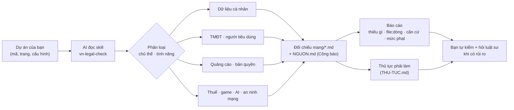

# vn-legal-skills


Bộ skill + checklist giúp AI (Claude Code, Codex, Cursor…) **rà một web/app nhỏ ở Việt Nam theo luật VN**:
dữ liệu cá nhân, người tiêu dùng, thương mại điện tử, quảng cáo, bản quyền, an ninh mạng, AI, trò chơi điện tử, thuế và hoá đơn.

> ⚠️ **Không phải tư vấn pháp lý — chỉ để tham khảo.** Đây là công cụ nhắc việc: chỉ ra chỗ cần xem lại và dẫn văn bản
> gốc để bạn tự đọc. Nó **không** chứng nhận app của bạn hợp pháp, **không** tạo quan hệ luật sư – khách hàng,
> và có thể sai hoặc lỗi thời; AI dùng nó cũng có thể sai. Bạn tự chịu trách nhiệm về sản phẩm của mình;
> việc có rủi ro tiền/phạt ⇒ hỏi luật sư. Dùng repo = chấp nhận **[MIEN-TRU-TRACH-NHIEM.md](MIEN-TRU-TRACH-NHIEM.md)**.
> Luật cập nhật tới: **2026-10-24** (xem [NGUON.md](NGUON.md)).

## Skill hoạt động thế nào



**Ví dụ một dòng báo cáo:** "Ô đồng ý nhận email đang tick sẵn — `signup.js:42` — NĐ 330/2026 Điều 43 khoản 1 điểm c — 30–50 triệu (tổ chức; cá nhân/hộ kinh doanh một nửa)."

## Luật nguồn

- Mọi văn bản dẫn tới **cổng chính thức của Nhà nước** (Công báo, vanban.chinhphu.vn, vbpl.vn, *.gov.vn). Không dùng trang tổng hợp tư nhân.
- Checklist **chỉ trích số điều** khi văn bản đó đã được đối chiếu toàn văn (cột "Kiểm" trong [NGUON.md](NGUON.md)). Chưa đối chiếu ⇒ ghi tên văn bản, không bịa số điều.

## Cấu trúc — chia theo mảng

```
MIEN-TRU-TRACH-NHIEM.md          miễn trừ trách nhiệm — đọc trước
AGENTS.md                        lối vào cho Codex/Cursor/model khác
scripts/kiem-nhat-quan.py        cổng kiểm các tệp khớp nhau (chạy trước mỗi commit)
LICH-SU-THAY-DOI.md              luật cũ → mới: ngày hiệu lực, chuyển tiếp, mục bị ảnh hưởng
luu-tru/                         nguyên văn nội dung cũ trước mỗi lần luật đổi
CONTRIBUTING.md                  cách góp ý (issue/PR) + luật nội dung
THU-TUC.md                       thủ tục phải làm với cơ quan nhà nước theo tính năng (skill nhắc trong báo cáo)
LO-TRINH.md                      20 mảng: đã làm / đang làm / chưa làm
NGUON.md                         bảng văn bản: số hiệu · ngày · hiệu lực · link chính thức · đã kiểm tới đâu
skills/
  vn-legal-check/SKILL.md        skill điều phối: hỏi app làm gì → chọn mảng → rà → báo cáo
mang/                            mỗi mảng một tệp: áp khi nào · việc phải có · dấu hiệu lỗi trong mã · nguồn
  01-du-lieu-ca-nhan.md
  02-nguoi-tieu-dung.md
  03-thuong-mai-dien-tu.md
  04-quang-cao.md
  05-ban-quyen.md
  06-an-ninh-mang.md
  07-tri-tue-nhan-tao.md
  08-tro-choi-dien-tu.md
  09-thue-hoa-don.md
  11-thanh-toan.md
kiem-thu/                        bộ câu hỏi kiểm thử skill (có / không có skill)
.claude-plugin/                  đóng gói plugin Claude Code
trich-dan/                       đoạn trích NGUYÊN VĂN từ PDF Công báo (bằng chứng cho số điều, mức phạt)
mau/                             mẫu văn bản để trống [CHỖ ĐIỀN], tự viết, không chép của ai
  chinh-sach-quyen-rieng-tu.md
  dieu-khoan-su-dung.md
```

## Dùng

**Claude Code — cài bằng plugin (gọn nhất):**

```
/plugin marketplace add Tiro-dev-NT/vn-legal-skills
/plugin install vn-legal-check@vn-legal-skills
```

Rồi mở dự án của bạn và nói: *"rà dự án này theo luật Việt Nam"*. <!-- cài plugin chưa được thử trên máy thật lúc viết (25/10/2026) -->

**Cách thủ công (mọi AI):**


Luôn giữ **cả repo** (skill cần `mang/` và `NGUON.md`; thiếu thì skill dừng phần kết luận, không tự điền).

**Claude Code:** clone repo vào `~/.claude/skills/vn-legal-skills/` rồi tạo liên kết/chép `skills/vn-legal-check/` lên một cấp,
hoặc đơn giản mở dự án của bạn và nói: *"đọc <đường dẫn>/vn-legal-skills/skills/vn-legal-check/SKILL.md rồi rà dự án này"*.

**Codex, Cursor, Gemini CLI, model khác:** dùng cùng câu trên, hoặc đặt repo cạnh dự án — [AGENTS.md](AGENTS.md) trỏ tới skill.
Mọi tệp là Markdown thuần, không phụ thuộc nhà cung cấp. Model nhỏ có thể bỏ sót luật cứng — đọc lại phần "Mức phạt" trong báo cáo trước khi tin.

Skill **chỉ đọc mã và viết báo cáo**; không sửa mã, không gọi mạng ngoài việc mở link nguồn.

## Kiểm thử

[`kiem-thu/`](kiem-thu/README.md): 10 câu hỏi kèm ý phải có / không được có, mỗi ý có căn cứ trong repo — dùng để so AI có skill và không có skill.

## Dự án liên quan

| Dự án | Khác gì |
|---|---|
| [Vietnam PDPL skill](https://github.com/sushegaad/claude-skills-governance-risk-and-compliance) (trong bộ GRC skills) | Tiếng Anh, chuyên sâu **một** mảng dữ liệu cá nhân (Luật 91/2025, NĐ 356/2025) dạng cố vấn. Repo này: tiếng Việt, 9 mảng, rà thẳng mã nguồn ra `file:dòng`, kèm mức phạt đã đối chiếu và thủ tục phải làm. Dùng cả hai được. |
| [awesome-legal-skills](https://github.com/lawve-ai/awesome-legal-skills) | Danh sách tổng hợp skill pháp lý nhiều nước. |

Biết dự án nào khác về luật Việt Nam cho dân làm app? Mở Issue để thêm vào đây.

## Góp sức

Xem **[CONTRIBUTING.md](CONTRIBUTING.md)**: báo lỗi / luật mới bằng Issue (có mẫu sẵn, không cần biết Git), sửa bằng PR;
GitHub Action chạy cổng kiểm cho mỗi PR. Người góp tự động hiện trong mục Contributors khi PR được merge.
Luật thay đổi ⇒ xem [LICH-SU-THAY-DOI.md](LICH-SU-THAY-DOI.md).

## English summary

**vn-legal-skills** is an open-source Agent Skill (Claude Code plugin, also usable with Codex/Cursor via `AGENTS.md`) that reviews a web/app project against **Vietnamese law**: personal data (Law 91/2025, Decree 356/2025, penalties Decree 330/2026), consumer protection, e-commerce (Law 122/2025, Decree 248/2026), advertising, copyright incl. data scraping/APIs/licences, cybersecurity, AI (Law 134/2025), online games, tax and e-invoices. Only official sources (Official Gazette); article numbers and fines are quoted from full texts, with individual vs organisation fine levels. Output: findings with `file:line`, legal basis, fine range, and the administrative procedures to file. Content is in Vietnamese. **Not legal advice.**

## Giấy phép

MIT — xem [LICENSE](LICENSE). Văn bản pháp luật trích dẫn không thuộc đối tượng bảo hộ quyền tác giả;
phần checklist và mẫu là nội dung tự viết của repo.
